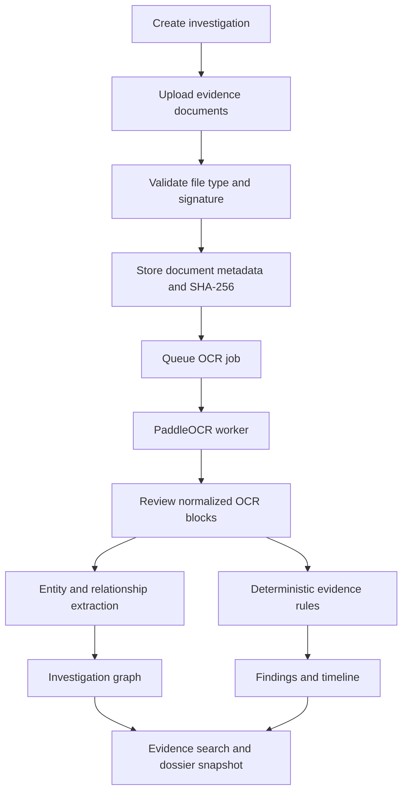

# DocForensIQ

### AI-Powered Document Forensics & Contextual Intelligence

> Turn a collection of documents into an evidence-linked investigation workspace. Upload records, review OCR, connect entities, inspect discrepancies, reconstruct timelines, and export investigation snapshots—with traceability kept at the center.

[Repository](https://github.com/ThePranish03/AI-Powered-Document-Forensics-and-Contextual-Intelligence-System) · [API docs (local)](http://localhost:8000/docs) · [Frontend (local)](http://localhost:5173)

---

## At a glance

| | Stack |
|---|---|
| **Backend API** | FastAPI · Python · SQLAlchemy (async) · Alembic |
| **Frontend** | React · TypeScript · Vite |
| **Database** | SQLite for direct local development · PostgreSQL with Docker Compose |
| **OCR** | PaddleOCR PP-StructureV3 via an isolated worker |
| **Relationship extraction** | Optional Grok structured extraction (xAI or Vercel AI Gateway) |
| **Local orchestration** | Docker Compose · Windows PowerShell launcher |

## What it does

- **Investigation workspace** — create and manage creator-owned investigations.
- **Evidence intake** — upload PDF, JPEG, PNG, or TIFF documents; metadata and SHA-256 hashes are stored.
- **OCR processing & review** — process queued documents through a dedicated PaddleOCR worker and inspect normalized OCR blocks.
- **Entity and relationship discovery** — optional structured extraction with source block references; deterministic identifier nodes are also available.
- **Evidence-linked findings** — rule-based findings and timeline events are persisted with review notes.
- **Integrity & audit trail** — hash-chained audit events and document hash records support traceability.
- **Dossier snapshots** — generate HTML/JSON snapshots of an investigation.
- **OCR evaluation** — compare extracted text with supplied ground truth using CER, WER, exact match, and detection F1.
- **Evidence search** — find matching OCR blocks and findings.
- **Limited visual signals** — available signals are intentionally constrained; automated document forgery analysis is not currently implemented.

## Investigation flow



## Quick start (verified repository commands)

Choose one startup mode. Do not start the local launcher and Docker stack at the same time; both use the same default ports.

### Windows local launcher

Prerequisites: Windows PowerShell, Node.js/npm, `uv`, and the separate PaddleOCR evaluation environment at `../extra_things/PaddleOcr/ocr_evaluation` (or set `PADDLEOCR_PYTHON` in `backend/.env` to its Python executable).

From the repository root:

```powershell
powershell -ExecutionPolicy Bypass -File .\\run-local.ps1
```

The script creates missing local env files from examples, syncs backend dependencies, applies Alembic migrations, checks the PaddleOCR runner, and starts the API, OCR worker, and Vite frontend. It opens the frontend at `http://localhost:5173`; API docs are at `http://localhost:8000/docs`. Logs are written to `logs/`. Press `Ctrl+C` in the launcher terminal to stop its child processes.

### Docker Compose

From the repository root, configure the root Compose environment and backend environment before starting:

```powershell
Copy-Item .env.example .env
Copy-Item backend/.env.example backend/.env
docker compose up -d --build
```

Open `http://localhost:5173`; API docs: `http://localhost:8000/docs`. Follow logs with `docker compose logs -f api ocr-worker`; stop containers with `docker compose down`. This preserves named volumes. Do not use `docker compose down -v` unless you intentionally want to delete the development database and persisted evidence volumes.

To provision an administrator, set unique `ADMIN_EMAIL` and `ADMIN_PASSWORD` values in the project-root `.env`, then run:

```powershell
docker compose exec api python -m scripts.seed_admin
```

### Run API and frontend separately

Backend (Python 3.12, from the repository root):

```powershell
cd backend
py -m pip install uv
uv sync --python 3.12 --extra test --locked
Copy-Item .env.example .env
uv run alembic upgrade head
uv run uvicorn app.main:app --reload
```

In a second terminal, start the isolated OCR worker using the configured PaddleOCR runtime (the launcher is the recommended local orchestration path). In a third terminal, start the frontend:

```powershell
cd frontend\\DocForensIQ-frontend
Copy-Item .env.example .env.local
npm ci
npm run dev
```

The direct backend defaults to SQLite unless `DATABASE_URL` is changed. The API does not create tables automatically: always run `uv run alembic upgrade head` after configuring the database.

### Configuration and optional provider

Use the root `.env.example` for Docker Compose settings, `backend/.env.example` for API/worker settings, and `frontend/DocForensIQ-frontend/.env.example` for Vite settings. Copy them to the corresponding local filenames above; never commit real `.env` files. Relationship extraction is optional and disabled unless `RELATIONSHIP_EXTRACTION_ENABLED=true` is set in the backend environment with a valid provider configuration. The provider key must remain server-side and must never be placed in a `VITE_*` variable. The PaddleOCR runtime is separate from this relationship-extraction provider.

### First investigation workflow

1. Start the services and sign in (or provision the admin in Docker mode as described above).
2. Create an investigation from the workspace.
3. Upload PDF, JPEG, PNG, or TIFF evidence (maximum 25 MiB per upload).
4. Watch the document processing status; open the document review to inspect OCR output when complete.
5. Inspect the entity/relationship results and their source references. Optional provider-backed extraction requires its backend configuration; deterministic identifier-based candidates may still be available.
6. Review findings, timeline, and evidence search results. Open citations against the originating document and page.
7. Create a dossier snapshot and inspect its HTML/JSON output; verify the audit chain from the audit area.

Feature availability and automated-vs-manual analysis boundaries are described in [Current limitations](#current-limitations). Findings and candidate links are investigative leads and must be checked against original evidence.

## Architecture

```text
DocForensIQ/
├── backend/                         # FastAPI API, persistence, OCR worker, tests
├── frontend/
│   └── DocForensIQ-frontend/        # React + TypeScript + Vite workstation
├── docker-compose.yml               # PostgreSQL, API, frontend, OCR worker
├── run-local.ps1                    # Windows local development launcher
└── .env.example                     # Compose configuration template
```

## Run locally

### Option A — Windows one-command launcher

Prerequisites: Node.js, `uv`, and the sibling PaddleOCR evaluation environment described below.

From the **DataOps project root**:

```powershell
powershell -ExecutionPolicy Bypass -File .\run-local.ps1
```

The launcher applies backend migrations, starts the API and OCR worker, starts Vite, opens the frontend, and writes service logs under `logs/`. It creates local environment files from examples when missing. Press `Ctrl+C` in the launcher terminal to stop its services.

The PaddleOCR environment is expected at `../extra_things/PaddleOcr/ocr_evaluation`. Follow that project's README to set it up, then configure `PADDLEOCR_PYTHON` in `backend/.env` if its Python executable is elsewhere.

### Option B — Docker Compose

From the project root:

```powershell
Copy-Item .env.example .env
Copy-Item backend/.env.example backend/.env
docker compose up -d --build
```

- Frontend: `http://localhost:5173`
- API: `http://localhost:8000`
- API docs: `http://localhost:8000/docs`

View logs and stop services:

```powershell
docker compose logs -f api ocr-worker
docker compose down
```

To provision an administrator, set `ADMIN_EMAIL` and `ADMIN_PASSWORD` in the **project-root** `.env`, then run:

```powershell
docker compose exec api python -m scripts.seed_admin
```

Use a unique password of at least 12 characters. Example credential values are intentionally blank.

### Option C — Run API and frontend separately

Backend (Python 3.12):

```powershell
cd backend
py -m pip install uv
uv sync --python 3.12 --extra test --locked
Copy-Item .env.example .env
uv run alembic upgrade head
uv run uvicorn app.main:app --reload
```

Frontend (separate terminal):

```powershell
cd frontend\DocForensIQ-frontend
Copy-Item .env.example .env.local
npm ci
npm run dev
```

Configure the frontend API URL and registration/demo settings in `.env.local`. For direct local backend use, SQLite is the default; change `DATABASE_URL` to use PostgreSQL. **Migrations are required**—the API does not create database tables on startup.

## Optional relationship extraction

Relationship extraction is disabled unless configured. Set `RELATIONSHIP_EXTRACTION_ENABLED=true` and configure a provider in `backend/.env`.

**Vercel AI Gateway**

```dotenv
XAI_BASE_URL=https://ai-gateway.vercel.sh/v1
XAI_MODEL=spacexai/grok-4.7
```

**Direct xAI API**

```dotenv
XAI_BASE_URL=https://api.x.ai/v1
XAI_MODEL=grok-4.7
```

Keep provider API keys server-side; never place them in `VITE_*` variables. Gateway inference may require billing setup at the provider.

## Tests & quality checks

Backend:

```powershell
cd backend
uv sync --python 3.12 --extra test --locked
uv run pytest
uv run alembic upgrade head
```

Frontend:

```powershell
cd frontend\DocForensIQ-frontend
npm run typecheck
npm run lint
npm run test
npm run build
```

Tests cover session and password flows, authorization scoping, dashboard aggregates, frontend route/session behavior, investigation creation, uploads and hashes, PDF signature screening, and OCR block normalization.

## Security & evidence handling

- Login and refresh tokens use HttpOnly, SameSite=Strict cookies; CSRF checks protect authenticated state-changing requests.
- Passwords are hashed with Argon2id. Refresh tokens are stored as SHA-256 hashes and rotated/revoked.
- CORS is restricted to the configured frontend origin; production cookies require HTTPS.
- Investigation access is creator-scoped. No workspace-membership model is currently provided.
- Upload screening checks declared file type against signatures. This is **not** complete PDF parsing or malware scanning.
- Treat uploaded evidence and local email-sink reset payloads as sensitive. Never commit `.env` files, real documents, local databases, or uploads.

## Current limitations

- Production email delivery and email verification are not implemented; password-reset email payloads use a local development sink.
- Authentication rate limiting is in-memory per API process; use a shared limiter before horizontal scaling.
- OCR is processed by a database-polled worker, not a distributed queue. Stale jobs are marked failed and documents have up to three explicit retries.
- Supported upload formats are PDF, JPEG, PNG, and TIFF; Office files are not accepted.
- Relationship graph results are extracted or identifier-based candidates; shared identifiers are not proof that parties are the same.
- Findings and timeline are rule-based. Visual review is manual: automated font, copy-move, compression, and forgery checks are unavailable.
- Evidence search returns matching OCR blocks and findings; it does not perform LLM-based grounded question answering.
- OCR evaluation compares against user-supplied ground truth; it does not benchmark a second OCR engine or report GPU/latency metrics.
- Production deployment infrastructure and operational secret management are outside the current repository scope.

## Contributing

Contributions and issue reports are welcome. Please keep changes focused, add or update tests where appropriate, and avoid committing secrets or real investigation evidence.

## Responsible use

DocForensIQ is an investigation support tool. Its findings are indicators to review—not a determination of fraud, guilt, or legal liability. Verify material conclusions against the original evidence and preserve human review.

---

<p align="center">Built for evidence-first document investigation.</p>
