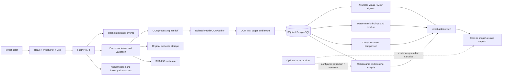
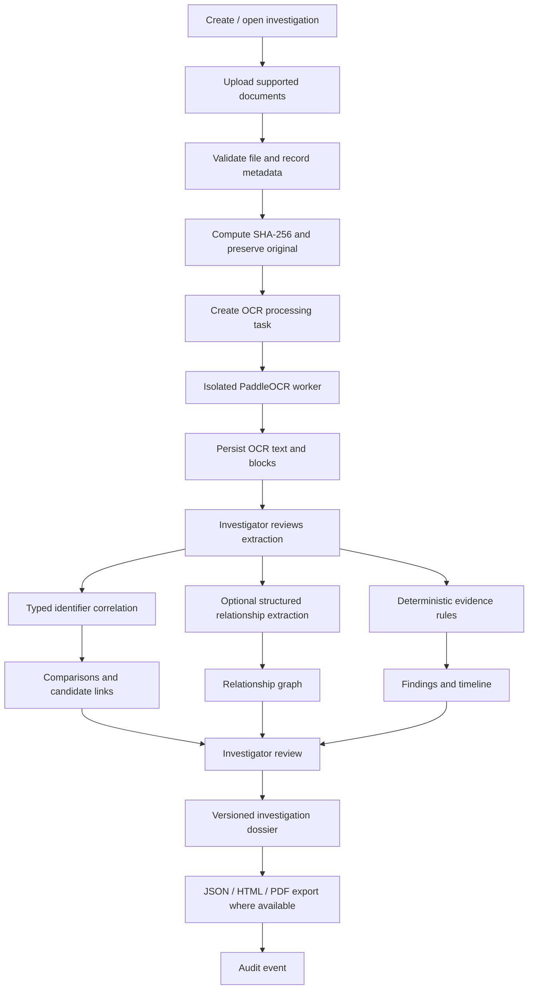
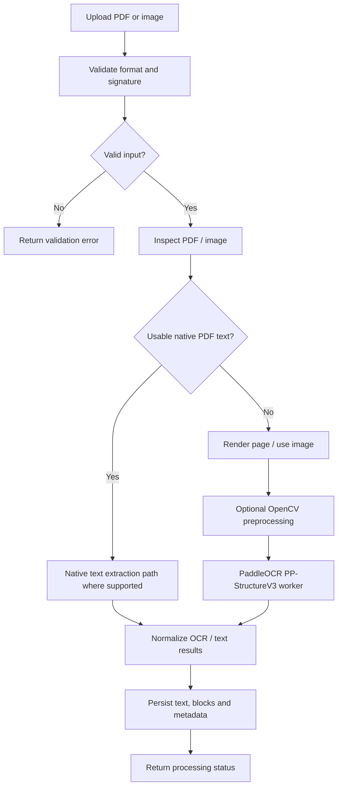

# DocForensIQ

### AI-Powered Document Forensics and Contextual Intelligence System

> **Beyond OCR. Evidence-led document intelligence.** DocForensIQ organizes source documents into an investigation workspace, extracts and reviews OCR evidence, correlates related records, surfaces explainable candidate discrepancies, and produces versioned investigation reports with traceability at the center.

**Team:** Team Resilience  
**Team leader:** Pranish Belsare  
**Team member:** Varad Bachal

[Repository](https://github.com/ThePranish03/AI-Powered-Document-Forensics-and-Contextual-Intelligence-System) · [Frontend (local)](http://localhost:5173) · [API (local)](http://localhost:8000) · [API docs (development)](http://localhost:8000/docs)

## Run the application locally

### Prerequisites

- Windows PowerShell for the documented launcher commands.
- Node.js/npm for the frontend.
- Python 3.12 and `uv` for the backend.
- Docker Desktop and a Docker Compose version supporting named additional build contexts if using containers.
- The sibling PaddleOCR evaluation/runtime project required by the OCR worker setup.
- Environment files configured from the supplied examples.

### Option A — Windows one-command launcher

From the project root:

```powershell
powershell -ExecutionPolicy Bypass -File .\run-local.ps1
```

The repository README documents this launcher as applying backend migrations, starting the API and OCR worker, starting Vite, opening the frontend, and writing service logs under `logs/`. Press `Ctrl+C` in the launcher terminal to stop the services.

The PaddleOCR environment is expected at:

```text
../extra_things/PaddleOcr/ocr_evaluation
```

Configure `PADDLEOCR_PYTHON` in `backend/.env` if the worker's Python executable is elsewhere.

### Option B — Docker Compose

From the repository root:

```powershell
Copy-Item .env.example .env
Copy-Item backend/.env.example backend/.env
docker compose up -d --build
```

The OCR worker build uses the sibling `../extra_things/PaddleOcr/ocr_evaluation` directory as a named build context. Keep that project available beside this repository.

View logs:

```powershell
docker compose logs -f api ocr-worker
```

Stop services:

```powershell
docker compose down
```

To provision an administrator, set `ADMIN_EMAIL` and `ADMIN_PASSWORD` in the **project-root** `.env`, then run:

```powershell
docker compose exec api python -m scripts.seed_admin
```

Use a unique password of at least 12 characters. Keep credentials private.

### Option C — Run API and frontend separately

**Backend (Python 3.12):**

```powershell
cd backend
py -m pip install uv
uv sync --python 3.12 --extra test --locked
Copy-Item .env.example .env
uv run alembic upgrade head
uv run uvicorn app.main:app --reload
```

**Frontend (separate terminal):**

```powershell
cd frontend\DocForensIQ-frontend
Copy-Item .env.example .env.local
npm ci
npm run dev
```

Configure the frontend API URL and registration/demo settings in `.env.local`. SQLite is the direct local-development default; PostgreSQL can be selected through `DATABASE_URL`.

**Important:** Apply Alembic migrations before starting the API. The API does not create database tables automatically.

### Local service URLs

| Service | URL |
|---|---|
| Frontend | http://localhost:5173 |
| Backend | http://localhost:8000 |
| Health check | http://localhost:8000/health |
| API docs (development) | http://localhost:8000/docs |

---

---

## Table of contents

1. [Run the application locally](#run-the-application-locally)
1. [Project overview](#1-project-overview)
2. [Problem statement](#2-problem-statement)
3. [Objectives and novelty](#3-objectives-and-novelty)
4. [Capabilities and application walkthrough](#4-capabilities-and-application-walkthrough)
5. [Architecture at a glance](#5-architecture-at-a-glance)
6. [End-to-end investigation workflow](#6-end-to-end-investigation-workflow)
7. [Technology stack](#7-technology-stack)
8. [Document intake and evidence integrity](#8-document-intake-and-evidence-integrity)
9. [OCR and structured information extraction](#9-ocr-and-structured-information-extraction)
10. [Relationship analysis](#10-relationship-analysis)
11. [Cross-document comparison](#11-cross-document-comparison)
12. [Findings and evidence traceability](#12-findings-and-evidence-traceability)
13. [Visual review and forensic signals](#13-visual-review-and-forensic-signals)
14. [Timeline and evidence search](#14-timeline-and-evidence-search)
15. [Investigation dossier and exports](#15-investigation-dossier-and-exports)
16. [LLM integration and responsible AI](#16-llm-integration-and-responsible-ai)
17. [Security, privacy and audit](#17-security-privacy-and-audit)
18. [Repository structure](#18-repository-structure)
20. [Configuration](#20-configuration)
21. [Testing and evaluation](#21-testing-and-evaluation)
22. [Current limitations and implementation boundaries](#22-current-limitations-and-implementation-boundaries)
23. [Demo walkthrough](#23-demo-walkthrough)
24. [Responsible use](#24-responsible-use)

---

## 1. Project overview

DocForensIQ is a document-focused investigation workspace. It is intended for workflows in which an investigator must review multiple related records—such as purchase orders, invoices, bank statements, vendor ledgers, applications, identity records, and supporting documents—and understand how information across those records fits together.

A conventional OCR system returns recognized text. DocForensIQ builds an investigation workflow around the extracted content:

- Preserve source-document metadata and a SHA-256 digest.
- Process supported files through a dedicated OCR worker.
- Review normalized OCR blocks and their source context.
- Discover candidate relationships through typed identifiers and optional structured extraction.
- Compare labelled values across documents.
- Generate deterministic, evidence-backed candidate findings.
- Reconstruct a timeline from recognized dates.
- Review findings and relationship candidates.
- Create versioned investigation dossier snapshots and export reports.
- Record important actions in an audit chain.

### Core principle

**Deterministic evidence processing first; AI-assisted interpretation second.**

OCR, parsing, normalization, identifier matching and deterministic rules provide the factual inputs to the analysis. Optional language-model functionality can help extract structured relationships or draft evidence-grounded narrative. It must not invent missing facts, silently modify source values, or decide that a document is fraudulent or authentic.

---

## 2. Problem statement

The problem is not only missing text; it is missing context.

Financial and administrative investigations often involve information distributed across several documents. Each document may be readable in isolation, while inconsistencies become visible only when related records are compared.

Common challenges include:

- Manually comparing amounts, identifiers, names, dates and vendor details across many files.
- Recognizing when two documents refer to the same transaction or reference.
- Distinguishing a genuine discrepancy from a harmless formatting variation.
- Tracking an extracted value back to its original page and text region.
- Preserving review decisions and the history of investigative actions.
- Producing a structured report that explains both the observations and their limitations.

OCR alone does not solve these challenges. OCR can also misread low-quality scans or confuse visually similar characters. Its output must therefore remain linked to the original source and be treated as extracted evidence—not unquestionable ground truth.

---

## 3. Objectives and novelty

### Project objectives

1. Provide a case-oriented workspace for document investigations.
2. Preserve uploaded evidence metadata and file digests.
3. Extract text and layout information from supported documents.
4. Organize extracted information into reviewable OCR blocks.
5. Link related documents using typed identifiers and available relationship evidence.
6. Compare labelled values across semantically related records.
7. Surface candidate discrepancies through deterministic rules.
8. Provide source references so investigators can inspect the underlying evidence.
9. Maintain review decisions, timeline events and audit history.
10. Generate versioned investigation reports.

### Novelty: evidence-first contextual document intelligence

The central innovation is the combination of several investigation activities in one traceable workflow:

- **Contextual cross-document intelligence:** compare related documents rather than treating every file independently.
- **Evidence-linked candidate findings:** connect a discrepancy to the source document and available page/block references.
- **Unified investigation workspace:** bring intake, OCR review, relationship analysis, comparison, findings, timeline and dossier generation together.
- **Explainable and human-guided review:** show the method and evidence behind a candidate observation, then let an investigator record a disposition.
- **Versioned reporting:** preserve a report snapshot and record export activity.
- **Deterministic core with optional AI assistance:** use code for exact comparisons and rules; use an LLM only for bounded extraction or narrative tasks when configured.

> **Core novelty statement:** DocForensIQ turns disconnected documents into connected, traceable and reviewable investigative evidence—going beyond OCR without replacing investigator judgment.

---

## 4. Capabilities and application walkthrough

The React application is organized as a workspace with investigation-level navigation. Exact page content depends on the selected investigation and data already processed.

| Area | Purpose |
|---|---|
| Workspace / Investigations | Entry point for investigation records and workspace navigation. |
| New Investigation | Create a new investigation with its case metadata. |
| Investigation Overview | Review case context, document inventory and processing status. |
| Processing / Documents | Upload supported files, inspect processing state and review OCR outputs. |
| Classification | Classification-related navigation and document context; do not assume a separate classifier is active unless verified in the deployed build. |
| Structure & Visual Forensics | Inspect document pages and available visual-analysis signals. |
| Extracted Data | Review recognized text, normalized blocks and available structured data. |
| Evidence Viewer | Inspect source files and navigate to cited pages or OCR regions where references exist. |
| Cross-Document Comparison | Review related documents, typed identifier matches and labelled-value differences. |
| Relationship Map | Explore deterministic and optional extracted relationship information. |
| Findings | Review persisted candidate findings and record investigator dispositions. |
| Timeline | Review events generated from recognized dates and supported activity. |
| Dossier | Generate and inspect saved report snapshots and export supported formats. |
| Audit Trail | Review recorded actions and integrity information. |
| Search | Search stored OCR blocks and findings. |
| OCR Evaluation | Run supported OCR metric calculations against supplied ground truth. |

### Local application addresses

- Frontend: http://localhost:5173
- Backend health: http://localhost:8000/health
- FastAPI documentation: http://localhost:8000/docs (development configuration only)

The landing page contains illustrative presentation content. Do not interpret example counters or synthetic previews as live investigation measurements.

---

## 5. Architecture at a glance

The architecture follows a modular application design: a React client communicates with a FastAPI backend; the API coordinates persistence and analysis; OCR is isolated in a worker/runtime; optional external AI providers are called server-side; and evidence, extraction results, findings, audit events and dossier snapshots are stored.

### Architecture diagram

The project architecture diagram is maintained in the project materials as **DocForensIQ Architecture.png**. If you add it to this repository, place it at `docs/architecture/DocForensIQ-Architecture.png`; the following link will then render it in GitHub:


The diagram should be read with its status annotations: some blocks are explicitly marked as proposed or not confirmed, including job handoff, evidence-file storage and some access/ownership details. A box in an architecture diagram is not, by itself, proof of a completed implementation.

### Logical architecture



### Main layers

| Layer | Responsibility |
|---|---|
| Frontend | Investigation workspace, upload, OCR review, comparison, graph, findings, timeline and dossier screens. |
| API and access control | Authentication, request validation, investigation-scoped access and orchestration. |
| Evidence intake | File validation, original-file storage, metadata and SHA-256 recording. |
| OCR worker | Isolated document OCR/layout processing and result persistence. |
| Canonical evidence records | Normalized OCR blocks, source references, document fields and analysis metadata. |
| Analysis services | Identifier correlation, comparison rules, findings and date extraction. |
| Relationship services | Deterministic nodes/links and optional structured relationship extraction. |
| Visual review | Available source inspection and measured signals, subject to runtime/check availability. |
| Finding/review layer | Candidate finding persistence and investigator disposition. |
| Dossier service | Versioned report snapshot, integrity digest and export rendering. |
| Audit service | Hash-linked record of important investigation actions. |

### Architecture decisions

- Start with a modular FastAPI application rather than splitting everything into microservices.
- Keep OCR runtime dependencies isolated from the API.
- Keep source evidence separate from derived OCR/previews.
- Use relational persistence for core records and graph projections initially.
- Keep comparison rules deterministic and field-aware.
- Keep LLM integration optional and provider-configurable.
- Represent long-running operations with explicit statuses and failures.
- Make every material analytical result traceable to source evidence.

---

## 6. End-to-end investigation workflow

1. **Create an investigation.** The investigator creates or opens a case.
2. **Upload evidence.** The backend validates a supported file, stores its original bytes, records metadata and computes SHA-256.
3. **Queue processing.** A document record and processing status are created; OCR work is made available to the worker.
4. **Run OCR.** The isolated PaddleOCR worker processes the supported input and returns text/layout information.
5. **Review extraction.** The investigator inspects recognized text and normalized OCR blocks.
6. **Build context.** Deterministic typed-identifier extraction and optional structured relationship extraction create links between records.
7. **Compare documents.** The backend compares labelled values where identifiers and semantic context support comparison.
8. **Generate candidate findings.** Deterministic evidence rules persist supported discrepancies and timeline events.
9. **Inspect evidence.** The investigator opens the source document and checks its page/block reference.
10. **Record disposition.** The investigator accepts, rejects, dismisses or marks a finding for further review, adding notes where appropriate.
11. **Generate a dossier.** A versioned snapshot is created from stored investigation data.
12. **Export and audit.** Supported report formats are downloaded and the export action is recorded.

### Investigation flow diagram



---

## 7. Technology stack

| Layer | Technology | Role |
|---|---|---|
| Frontend | React 19 | User interface and investigation workspace. |
| Language | TypeScript | Frontend typing and contracts. |
| Build/dev | Vite 7 | Development server and production build. |
| Routing | React Router 7 | Workspace and investigation navigation. |
| Server-state | TanStack Query | API fetching, caching and refresh. |
| Icons | Lucide React | Consistent UI iconography. |
| Backend | Python + FastAPI | REST API and orchestration. |
| Validation | Pydantic | Typed request/response validation. |
| ORM | SQLAlchemy async | Database access. |
| Migrations | Alembic | Versioned database schema changes. |
| Local database | SQLite | Direct local development default. |
| Container database | PostgreSQL | Docker Compose database option. |
| OCR | PaddleOCR PP-StructureV3 | Text detection/recognition and structure parsing. |
| OCR runtime | PaddlePaddle / PaddleX | PaddleOCR execution dependencies. |
| Image processing | OpenCV + NumPy | Image operations and available measured visual signals. |
| PDF processing | PyMuPDF | PDF pages, text and object inspection where used. |
| LLM | xAI Grok via xAI API or Vercel AI Gateway | Optional structured relationship extraction and evidence-grounded narrative. |
| PDF report | ReportLab | PDF generation in the later dossier implementation. |
| Orchestration | Docker Compose / PowerShell launcher | Local multi-service startup. |
| Backend tests | pytest | Backend unit and integration tests. |
| Frontend tests | Vitest | Frontend tests. |
| Code quality | TypeScript / ESLint | Type and lint checks. |

---

## 8. Document intake and evidence integrity

### Supported upload formats

The repository README currently documents application upload support for:

- PDF
- JPEG / JPG
- PNG
- TIFF

A broader list appears in the OCR technology planning document, but that list is not proof that the current application accepts those formats. Office documents, CSV, XML, JSON, EML, MSG, HTML and ZIP should not be advertised as supported application uploads unless the current implementation is extended and verified.

### Upload lifecycle

For each uploaded source, the intended application flow is:

- Validate the file type and inspect its signature using the implemented screening logic.
- Store the original file without modifying it.
- Record the filename, MIME type, file size, uploader, timestamp and source description.
- Compute and persist the SHA-256 digest.
- Create the evidence/document record and initial processing status.
- Store generated OCR outputs and previews as derived artifacts separate from the original.
- Retain processing errors and retry information.

### SHA-256 interpretation

SHA-256 supports byte-level integrity checking and detection of identical files. It does not establish the document's author, prove that it was genuine before upload, or establish authenticity. Duplicate bytes are an integrity signal, not a standalone forgery finding.

---

## 9. OCR and structured information extraction

### Primary engine: PaddleOCR

The supplied OCR technology note selects PaddleOCR as the primary pretrained text detection and recognition engine. The current evaluation harness invokes PaddleX PP-StructureV3. PaddleOCR is built on PaddlePaddle and is integrated behind an isolated worker boundary so application code is less coupled to the OCR framework internals.

### OCR responsibilities

- Accept supported source PDFs and images.
- Inspect PDF pages and use the actual configured native-text or page-rendering/OCR path.
- Apply configurable image preprocessing where enabled.
- Detect text regions and recognize printed text.
- Retain recognized text, region coordinates, confidence when returned, page number and processing metadata.
- Persist raw/normalized result records as implemented.
- Make OCR results available for investigator review.

### OCR processing flow



### Preprocessing operations

| Operation | Purpose | Caution |
|---|---|---|
| Resize | Increase small text usability or reduce oversized dimensions. | Evaluate quality and latency trade-offs. |
| Deskew / rotation correction | Correct tilted pages and text lines. | Avoid unnecessary transformations. |
| Denoising | Reduce scan noise and compression artifacts. | Can erase thin character strokes. |
| Contrast enhancement | Separate text from background. | May damage faint or already high-contrast text. |
| Grayscale conversion | Simplify image input where appropriate. | Preserve original color source. |
| Adaptive thresholding | Improve foreground/background separation. | Can damage colored or faint content. |

The original upload must remain available. Preprocessing should be configurable and evaluated rather than blindly applied to every document.

### OCR result concepts

| Result field | Meaning |
|---|---|
| Recognized text | Text returned by the engine; not ground truth. |
| Bounding box | Location of a text region on a source page. |
| Confidence | Engine-reported recognition signal where provided. |
| Page number | Source-page locator. |
| Provider and version | OCR engine/runtime that produced the result. |
| Processing status | Queued, processing, completed, partial or failed state, as supported. |

### OCR evaluation harness

The supplied `ocr_evaluation` utility is a separate evaluation harness, not the production document-ingestion API. Its documented commands include:

| Command | Purpose |
|---|---|
| `run-docling` | Convert one supported input and save JSON/Markdown. |
| `run-paddle` | Run PP-StructureV3 on an image/page and save raw prediction JSON. |
| `coverage` | Inspect basic input metadata and ZIP member coverage; not a complete format benchmark. |
| `score-text` | Compute CER and WER for reference and hypothesis text files. |
| `manifest-sroie` | Build a manifest from SROIE image/transcript pairs. |

Datasets discussed in the OCR materials:

- **SROIE:** receipt text detection/recognition.
- **CORD:** receipt text and structured information annotations.
- **FUNSD:** scanned forms and varied layouts.
- **DocLayNet:** document layout and region handling.

### Evaluation caveats

The supplied evaluation note reports a historical exploratory PaddleOCR pilot of nine SROIE pages with CER 22.45% and WER 57.34%. The SROIE manifest records were still unassigned to official splits. The note also records two timed CPU pages with 149.65 seconds mean/median latency under the pilot conditions.

These are small exploratory observations—not a held-out benchmark or a product accuracy/performance guarantee. The harness note states that aggregate held-out results, layout AP, table TEDS, full batch benchmarking and comparable Docling results were not documented in the supplied artifacts. Do not present unsupported OCR accuracy, speed or throughput claims.

---

## 10. Relationship analysis

Relationship analysis organizes extracted mentions and explicit references into a graph-like representation for investigation navigation.

### Relationship inputs

- Document metadata and types.
- Recognized OCR text and block references.
- Typed identifiers such as invoice numbers, purchase-order numbers, transaction references and account references.
- Extracted person and organization mentions where available.
- Optional LLM structured extraction when enabled.
- Existing investigator review decisions.

### Two complementary relationship paths

**1. Deterministic identifier relationships**

The backend can identify exact typed identifiers across documents and create candidate links. For example, a purchase-order identifier appearing in a purchase order and an invoice can connect the two records for inspection.

**2. Optional structured relationship extraction**

When configured, Grok can propose structured entity and relationship information from OCR content. The output should be validated and tied to exact source blocks. This path is optional and can fail if provider configuration, availability or billing is not available.

### Relationship types (conceptual examples)

- `references`: one document explicitly refers to another identifier/document.
- `same_party`: two records may refer to the same party, subject to sufficient evidence.
- `same_transaction`: documents share a transaction identifier.
- `supports`: a source supports a finding or claim.
- `contradicts`: values conflict under an approved comparison rule.
- `chronologically_precedes`: supported event ordering.
- `possible_relationship`: a weaker candidate connection.

### Graph interpretation

A relationship is a navigation and context signal, not proof by itself. Shared identifiers can be mistyped, reused or misread by OCR. Similar names can refer to different people. The graph should preserve the relationship basis, source document/page/block references and review status.

The initial architecture can use relational records and derived graph nodes. A separate graph database is not required for the current modular application.

---

## 11. Cross-document comparison

Cross-document comparison aligns semantically equivalent, labelled values across selected documents. The backend comparison rules—not frontend color logic or an LLM—own the comparison result.

### Comparison pipeline

1. Select documents from the same investigation.
2. Reuse stored OCR outputs.
3. Extract typed identifiers and labelled values.
4. Align fields to comparable semantic concepts.
5. Preserve original OCR text and normalize only with an explicit rule.
6. Check semantic comparability, units, currency, dates and periods.
7. Apply deterministic equality/tolerance checks.
8. Return the matrix, status, source references and explanation.
9. Let the investigator inspect the supporting source values.

### Comparison statuses

| Status | Meaning |
|---|---|
| **Consistent** | Values match under the configured normalization rule. |
| **Variation** | Different representations are treated as equivalent under an approved rule. |
| **Difference** | Comparable values do not match. |
| **Missing / Not available** | Value was not extracted or is absent; this is not automatically a mismatch. |
| **Not comparable** | Values have different meanings, periods, units or contexts. |
| **Ambiguous** | OCR, mapping or context is insufficient for safe classification. |
| **Not evaluated** | Field is outside the active comparison policy. |

### Example

A purchase order and invoice may share a typed purchase-order identifier. If their labelled totals are extracted as 80,000 and 85,000, the system can surface a candidate total discrepancy. If the purchase-order amount was OCR-read as `8o,ooo`, the normalization warning must remain visible because the letter O may have been confused with zero.

The comparison does not establish why the values differ. Possible explanations—such as a revision, tax treatment, partial billing, deductions or OCR error—must be investigated against the original source documents.

### Important comparison safeguards

- Do not compare gross salary to net bank credit as though they are the same field.
- Keep currency, period, unit and semantic meaning.
- Preserve raw OCR values next to normalized values.
- Do not convert missing values into differences.
- Avoid generic identifier matching against ordinary words.
- Do not treat date proximity as proof that two documents describe one transaction.
- Keep uncertainty visible and require source inspection for material discrepancies.

---

## 12. Findings and evidence traceability

The repository documents findings as deterministic OCR/rule-based candidates. A finding is a signal for review—not an automatic fraud determination.

A candidate finding may contain:

- Finding ID and type.
- Title and explanatory description.
- Analyzer name and version.
- Rule or method identifier.
- Severity/prioritization metadata.
- Confidence/score where available.
- Related document identifiers.
- Evidence references.
- Limitations and possible alternative explanations.
- Investigator review status and notes.

### Evidence locator

Where available, an evidence reference should identify:

- Source document ID and filename.
- SHA-256 of the original.
- Page number and page ID.
- OCR block ID or evidence-span ID.
- Quoted source text.
- Bounding box/region coordinates.
- OCR/extraction run metadata.
- Field type and analysis method.

The evidence viewer should use these references to open the original source and navigate to the relevant page/block/region. A finding without a reliable source locator should be treated cautiously.

### Human review lifecycle

Supported dispositions described in the application include:

- Accepted.
- Needs review.
- Rejected.
- Dismissed.

An investigator can record a note or rationale with the review action. Acceptance means the investigator recorded that disposition; it is not a legal determination or proof of fraud.

---

## 13. Visual review and forensic signals

Visual analysis requires careful interpretation.

The repository README currently describes visual review as manual and states that automated font, copy-move, compression and forgery checks are unavailable as a complete capability. The inspected service source contains measured visual-analysis routines and the API has a per-document visual-analysis-run path, but code presence does not establish that every check is enabled, validated or available in a given deployment.

The current deployment must be checked for per-check status before the feature is described as operational.

### Visual checks represented in inspected source

| Check | Described signal | Limitations |
|---|---|---|
| Font/baseline comparison | PDF text font and baseline characteristics. | Different text styles and layout can be legitimate. |
| Copy-move screening | ORB feature matching with spatial/geometric checks within a page. | Logos, tables and repeated document elements can produce matches. |
| Compression/resampling screening | Local rendered texture and 8×8 JPEG boundary-gradient variation. | Screening signal only; cannot identify cause or prove alteration. |
| PDF object inspection | Image/text placement and transparency. | Overlap and transparency are common legitimate PDF features. |

### Visual review workflow

1. Select a document.
2. Open the source PDF/image.
3. Run analysis only if the deployed endpoint and dependencies are available.
4. Review each check's status and diagnostics.
5. Inspect candidate region boxes and measurements.
6. Open the original page and manually inspect the region.
7. Record an investigator disposition where supported.

### Meaning of a completed run with zero observations

“No candidate observations met the implemented thresholds” means the executed checks did not produce a candidate over their current thresholds. It does **not** establish authenticity or rule out alteration. A candidate signal likewise does not prove manipulation.

---

## 14. Timeline and evidence search

### Timeline

The timeline organizes supported dates extracted from OCR and investigation activity. A date event should retain its raw date text and source reference. Ambiguous date formats and unknown time zones must not be silently guessed. Chronological order does not by itself prove causation.

### Evidence search

The repository describes search over stored OCR blocks and findings. This is evidence retrieval; it is not a general-purpose LLM question-answering system. Search results should be inspected in their source context before being used in a conclusion.

---

## 15. Investigation dossier and exports

The dossier is intended to preserve a point-in-time investigation snapshot.

The later implementation summary in the project work reports support for:

- JSON export.
- Standalone HTML export.
- PDF export using ReportLab.
- Saved report versions.
- Snapshot SHA-256 integrity verification.
- Audit events for dossier generation/export, including actor, timestamp, format and version.
- Evidence references including page/block/coordinates where stored.

Confirm the behavior in the current deployed branch before presenting it as live-browser verified.

### Report content

A dossier can consolidate stored data such as:

1. Investigation metadata and case summary.
2. Source document inventory and file digests.
3. Processing status and OCR provider/run metadata.
4. Extracted OCR text and block references.
5. Cross-document comparisons and identifier links.
6. Relationship analysis.
7. Candidate findings and investigator review decisions.
8. Timeline events.
9. Visual analysis status and observations where available.
10. Audit-chain details.
11. Methodology, limitations and unresolved questions.

### Versioning and integrity

Each saved snapshot should be treated as an immutable report version. Its integrity digest is checked before export. Export actions should be auditable. A failed integrity check should block the download rather than silently returning modified content.

Optional LLM narrative generation is configuration- and provider-dependent. The implementation summary says narrative claims must resolve to exact stored OCR block text; if citations cannot be resolved, the narrative is omitted. A previously reported provider billing error means successful live model narrative generation should not be promised until tested.

---

## 16. LLM integration and responsible AI

### Provider configuration

The repository documents optional relationship extraction through:

- Direct xAI API.
- Vercel AI Gateway.

Relationship extraction is disabled unless `RELATIONSHIP_EXTRACTION_ENABLED=true` and provider credentials/configuration are set in the backend environment.

### Appropriate model tasks

- Propose structured entity/relationship extraction from supplied OCR content.
- Explain a deterministic finding using its cited evidence.
- Draft a summary of stored findings.
- Help formulate follow-up questions.
- Generate dossier narrative only when supported by retrievable source blocks.

### What the LLM must not do

- Invent missing document facts.
- Overwrite raw OCR values.
- Decide final equality or arithmetic outcomes that deterministic code can calculate.
- Create an unsupported candidate finding.
- Make a final fraud, guilt or authenticity determination.
- Treat document-embedded instructions as trusted system instructions.
- Produce unsupported summaries without citations.

Provider API keys must remain server-side. External model calls depend on provider configuration, availability and billing.

---

## 17. Security, privacy and audit

### Security controls documented by the repository

- Login and refresh tokens use HttpOnly, SameSite=Strict cookies.
- Passwords are hashed with Argon2id.
- Refresh tokens are stored as SHA-256 hashes and are rotated/revoked.
- CSRF checks protect authenticated state-changing requests.
- CORS is restricted to the configured frontend origin.
- Production cookies require HTTPS.
- Production configuration requires a strong JWT secret, PostgreSQL and an HTTPS frontend origin.
- Investigation access is creator-scoped.
- Security response headers are applied by the FastAPI application.
- Upload screening compares declared file type with signatures.

### Audit and integrity

Important actions are recorded in hash-linked audit events. The event chain supports tamper detection under the implemented model. It should be described as **tamper-evident, not tamper-proof**. A privileged actor who controls the database/storage may still be able to rewrite records unless stronger external protections are added.

### Security limitations

- No workspace-membership model is currently documented; investigation access is creator-scoped.
- Authentication rate limiting is in-memory per API process.
- Upload signature screening is not a complete malware-scanning solution or complete PDF sanitization.
- Production email delivery and email verification are not implemented; password-reset payloads use a local development sink.
- Production infrastructure and operational secrets management are outside the repository scope.
- Encryption at rest depends on the chosen database/storage/deployment configuration and should not be claimed unless configured and verified.

Never commit `.env` files, credentials, local databases, real documents or uploaded evidence.

---

## 18. Repository structure

```text
DocForensIQ/
├── backend/
│   ├── app/
│   │   ├── api/                  # FastAPI routes and dependencies
│   │   ├── core/                 # Settings and application security
│   │   ├── models/               # SQLAlchemy models
│   │   ├── schemas/              # Request/response schemas
│   │   └── services/             # OCR, analysis, correlation, audit, dossier
│   ├── migrations/               # Alembic schema migrations
│   ├── tests/                    # Backend tests
│   ├── scripts/                  # Administrative/development scripts
│   └── .env.example
├── frontend/
│   └── DocForensIQ-frontend/
│       ├── src/
│       │   ├── app/              # App setup and routing
│       │   ├── features/         # Investigation feature modules
│       │   ├── components/       # Shared UI components
│       │   └── ...
│       ├── package.json
│       └── .env.example
├── docker-compose.yml
├── run-local.ps1
├── .env.example
└── README.md
```

The tree above is a high-level guide; exact filenames and feature-module organization can evolve. The OCR evaluation project is maintained as a sibling build context at `../extra_things/PaddleOcr/ocr_evaluation` for the documented local/Docker workflow.

---

## 20. Configuration

### Core settings

| Variable | Purpose |
|---|---|
| `APP_ENV` | Environment mode; use `production` for production validation behavior. |
| `DATABASE_URL` | Async SQLAlchemy database URL. SQLite is the local default; production configuration requires PostgreSQL. |
| `JWT_SECRET` | Token signing secret. Production requires a strong secret of at least 32 characters and rejects common placeholder patterns. |
| `FRONTEND_ORIGIN` | Allowed frontend origin for CORS. Production requires HTTPS. |
| `SELF_REGISTRATION_ENABLED` | Controls self-registration. |
| `COOKIE_SECURE` | Secure-cookie behavior; enabled in production. |
| `ACCESS_TOKEN_MINUTES` | Access-token lifetime. |
| `REFRESH_TOKEN_DAYS` | Refresh-token lifetime. |
| `DOCUMENT_STORAGE_PATH` | Private document storage directory. |
| `XAI_API_KEY` | Optional server-side LLM provider key. |
| `XAI_BASE_URL` | Direct xAI or Vercel AI Gateway endpoint. |
| `XAI_MODEL` | Configured provider model. |
| `RELATIONSHIP_EXTRACTION_ENABLED` | Enables optional relationship extraction when set to `true`. |

### Optional relationship extraction

Relationship extraction is disabled unless explicitly enabled and configured in `backend/.env`.

**Vercel AI Gateway example:**

```dotenv
RELATIONSHIP_EXTRACTION_ENABLED=true
XAI_BASE_URL=https://ai-gateway.vercel.sh/v1
XAI_MODEL=spacexai/grok-4.7
XAI_API_KEY=your-server-side-provider-key
```

**Direct xAI example:**

```dotenv
RELATIONSHIP_EXTRACTION_ENABLED=true
XAI_BASE_URL=https://api.x.ai/v1
XAI_MODEL=grok-4.7
XAI_API_KEY=your-server-side-provider-key
```

These are configuration examples, not embedded credentials. Never place provider secrets in frontend `VITE_*` variables. Provider billing and availability can affect live inference.

---

## 21. Testing and evaluation

### Backend

```powershell
cd backend
uv sync --python 3.12 --extra test --locked
uv run pytest
uv run alembic upgrade head
```

### Frontend

```powershell
cd frontend\DocForensIQ-frontend
npm run typecheck
npm run lint
npm run test
npm run build
```

### Documented test coverage

The repository README describes tests for:

- Session/password flows and authorization scope.
- Dashboard aggregates and frontend route/session behavior.
- Investigation creation.
- Upload handling, file hashes and PDF signature screening.
- OCR block normalization.
- Cross-document exact typed-identifier clusters.
- Source citations and mismatched labelled totals.
- Typed identifier separation and false-match cases.
- Empty OCR and authorization scope.
- Review persistence across analysis reruns.
- Dossier inclusion and correlation audit events.

Always run the tests on the branch and worktree being released. Test counts reported during earlier development sessions are historical and are not a substitute for the current CI result.

### OCR evaluation notes

The OCR evaluation harness can calculate CER/WER from supplied text files and create an SROIE manifest. Its documentation says batch evaluation, arbitrary source-document rendering, layout AP, table TEDS, and a complete benchmark report are not yet provided by that harness. Use official dataset splits and a documented evaluation protocol before claiming OCR benchmark performance.

---

## 22. Current limitations and implementation boundaries

The following limitations are documented in the repository or supplied implementation notes. Check the current deployed branch before presenting a capability as live and complete.

- **Visual forensics:** the README describes manual visual review and states automated font, copy-move, compression and forgery checks are unavailable as a complete capability. Some later service/API work may contain measured routines, but each check must be validated and its per-check status exposed before claiming it is operational.
- **Upload formats:** application uploads are documented as PDF, JPEG, PNG and TIFF. Broader format lists in planning documents are not proof of application support.
- **Relationship extraction:** optional, disabled by default and dependent on configured provider access and billing.
- **Entity resolution:** exact typed identifier matching is available; fuzzy identity resolution and general-purpose semantic matching are not documented as implemented.
- **Cross-document matching:** deterministic OCR text rules match exact typed invoice, purchase-order, transaction, account and reference identifiers. A shared identifier is a candidate relationship, not proof.
- **Findings and timeline:** the repository documents these as rule-based.
- **Evidence search:** searches OCR blocks and findings; it is not general LLM-grounded question answering.
- **OCR benchmark:** no reproducible held-out aggregate benchmark or product-level OCR accuracy claim is established by the supplied evaluation note.
- **Email:** production email delivery and email verification are not implemented; password-reset payloads use a local development sink.
- **Rate limiting:** authentication rate limiting is in-memory per API process; a shared limiter is needed before horizontal scaling.
- **Background work:** OCR uses a database-polled worker rather than a distributed queue. Stale jobs are marked failed and explicit retries are limited.
- **Authorization model:** investigation access is creator-scoped; no workspace membership model is currently provided.
- **Upload security:** signature screening is not complete PDF sanitization or malware scanning.
- **Production operations:** production deployment infrastructure and operational secrets management are outside the current repository scope.
- **LLM availability:** live model calls depend on configuration, network access, provider availability and billing.

---

## 23. Demo walkthrough

Use a prepared synthetic investigation. Verify the backend, frontend, database and OCR worker are running before recording.

1. Sign in with an authorized demo account.
2. Open or create a synthetic investigation.
3. Upload supported PDFs/images.
4. Show file metadata, processing status and SHA-256 information.
5. Open OCR results and demonstrate source page/block context.
6. Open Cross-Document Comparison and explain one candidate discrepancy.
7. Open Relationships and explain the basis of a candidate link.
8. Open Findings and show a finding's evidence references and review actions.
9. Open Timeline if date events have been generated.
10. Open Visual Review only for checks that are actually available in the deployed build. Explain zero-observation and unavailable-check states accurately.
11. Generate a dossier and inspect its saved version.
12. Download the supported JSON, HTML and PDF formats.
13. Open Audit Trail and show the corresponding recorded actions.

### Suggested presentation language

Prefer:

- “The system surfaced a candidate discrepancy for investigator review.”
- “This value was extracted by OCR and should be checked against the source.”
- “The documents share this typed identifier, which provides a candidate link.”
- “No candidate observations met the implemented thresholds.”
- “This check is unavailable in the current build.”

Avoid:

- “Fraud detected.”
- “The document is authentic.”
- “The system proves these parties are the same.”
- “Every visual-forensics algorithm is fully implemented.”
- “The system is fully compliant” without a formal assessment.

---

## 24. Responsible use

DocForensIQ is an investigation-support tool. Automated outputs are indicators to review—not determinations of fraud, authenticity, guilt or legal liability.

Investigators should:

- Verify material observations against original evidence.
- Consider OCR errors and alternative explanations.
- Preserve source files and derived-artifact provenance.
- Review candidate relationships and findings.
- Record rationale for consequential dispositions.
- Include known limitations and unresolved evidence in reports.

---

## Contributing

Contributions and issue reports are welcome. Keep changes focused, add or update tests, follow the existing architecture and avoid committing secrets or real investigation evidence.

---

## References

- [PaddleOCR](https://github.com/PaddlePaddle/PaddleOCR)
- [PaddlePaddle](https://www.paddlepaddle.org.cn/)
- [OpenCV documentation](https://docs.opencv.org/)
- [PyMuPDF documentation](https://pymupdf.readthedocs.io/)
- [FastAPI documentation](https://fastapi.tiangolo.com/)
- [SQLAlchemy documentation](https://docs.sqlalchemy.org/)
- [Alembic documentation](https://alembic.sqlalchemy.org/)

---

<p align="center"><strong>DocForensIQ — Built for evidence-first document investigation.</strong></p>
